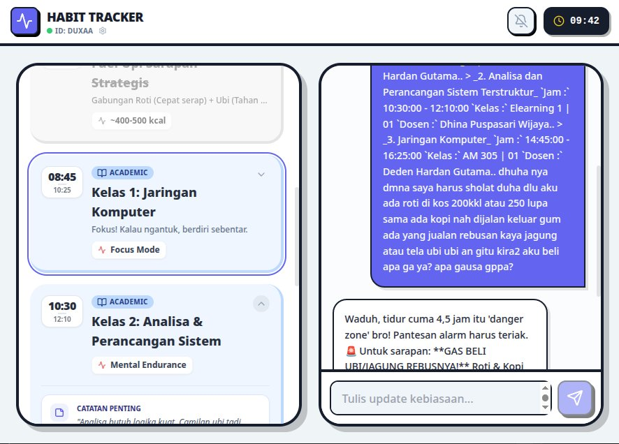

<div align="center">
  
  <h1>HABIT.AI</h1>
  <p>Ceritakan harimu apa adanya. AI yang menyusunnya jadi jadwal rapi.</p>
</div>

## Ini apa

HABIT.AI adalah perencana jadwal harian bertenaga AI. Kamu ketik atau paste aktivitasmu dengan bahasa sehari-hari ("kelas jam 8, habis itu gym, jangan lupa sholat"), AI memecahnya jadi jadwal terstruktur per jam, lengkap dengan sub-tugas, tips, dan pengingat.

Tidak ada form kaku yang harus diisi. Ngobrol saja, jadwalnya yang beres.

## Yang bisa dilakukan

- **Chat AI penjadwal.** Kirim pesan seperti ngobrol biasa. AI membalas dalam Bahasa Indonesia dan mengembalikan jadwal dalam format terstruktur: jam mulai, jam selesai, judul, deskripsi, sub-tugas, tips praktis, dan metrik (misal kalori makanan atau set x repetisi latihan).
- **Jadwal mikro per hari.** Tiap item dipecah sampai detail kecil, misal "cuci muka" di dalam "rutinitas pagi". Cocok buat yang harinya padat dan gampang buyar.
- **8 kategori.** Rutinitas, akademik, fitness, ibadah, kerja, makan, istirahat, lainnya. Tiap kategori punya warna dan ikon sendiri.
- **Pengingat beneran.** Notifikasi browser saat waktunya tiba, plus opsi suara yang membacakan pengingat (text-to-speech).
- **Tanpa password.** Daftar dan masuk pakai token. Data jadwalmu dienkripsi sebelum disimpan di browser.
- **Adaptif.** Jadwal berubah di tengah hari? Bilang saja ke AI, dia susun ulang tanpa menghapus yang sudah lewat.

## Cara menjalankan

Butuh Node.js versi 18 ke atas.

```bash
npm install
```

Buat file `.env.local` di root project, isi dengan API key Gemini kamu:

```
GEMINI_API_KEY=isi_api_key_kamu_disini
```

Dapatkan API key gratis di [Google AI Studio](https://aistudio.google.com/apikey).

```bash
npm run dev
```

Buka `http://localhost:3000` di browser.

Untuk build production:

```bash
npm run build
```

Hasilnya ada di folder `dist/`, siap disajikan sebagai file statis. API key ikut tertanam di bundle saat build, jadi pastikan `.env.local` sudah benar sebelum build.

## Cara kerja

1. Kamu kirim pesan lewat tab Chat.
2. Pesan + jadwal saat ini + ringkasan obrolan dikirim ke Gemini dengan skema output JSON yang ketat.
3. AI mengembalikan balasan singkat dan array jadwal yang sudah rapi.
4. Jadwal tampil di tab Schedule, lengkap dengan pengingat otomatis.

Model yang dipakai: `gemini-flash-latest`. (Sebelumnya memakai `gemini-3-pro-preview`, tapi model itu sudah dihentikan Google, jadi diganti.)

## Dibangun dengan

- React 19 + Vite 6 + TypeScript
- Google Gemini API (`@google/genai`)
- Tailwind CSS, Framer Motion, Lucide React
- Web Notifications API + Speech Synthesis untuk pengingat

## Struktur project

```
├── App.tsx                  # Komponen utama (jadwal, chat, auth, pengaturan)
├── components/
│   └── ScheduleItemCard.tsx # Kartu tiap item jadwal
├── services/
│   └── geminiService.ts     # Panggilan ke Gemini API + skema output
├── utils/
│   ├── audioUtils.ts        # Text-to-speech pengingat
│   ├── cryptoUtils.ts       # Enkripsi data + token pengguna
│   └── timeUtils.ts         # Helper waktu
├── docs/
│   └── banner.png           # Screenshot aplikasi
└── index.html
```
